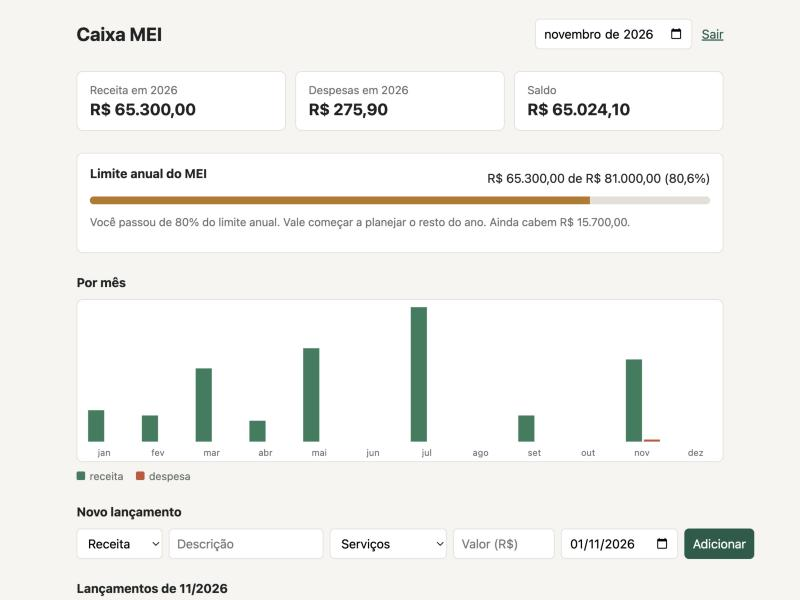

# Caixa MEI

Controle de entradas e saídas para MEI, com um medidor do limite anual de faturamento (R$ 81.000). Fiz porque vários conhecidos que trabalham como freelancer só descobrem que estouraram o limite quando o contador avisa, e aí já é tarde para planejar.



## O que faz

- Cadastro e login (JWT, senha com bcrypt)
- Lançamentos de receita e despesa, por mês
- Resumo do ano com gráfico mensal
- Medidor do limite do MEI com quatro faixas:
  - até 80%: tudo certo
  - 80% a 100%: atenção
  - até 120%: passou do limite, a diferença paga DAS adicional
  - acima de 120%: desenquadramento retroativo a janeiro
- Cada usuário só enxerga os próprios dados

## Stack

- **Front:** React 19, TypeScript, Vite. O gráfico é SVG feito à mão, não achei que valesse puxar uma lib só para barras.
- **API:** Express 5, zod para validar entrada, SQLite via `node:sqlite` (sem dependência nativa para compilar).
- **Testes:** `node:test`, sem framework extra.

Valores ficam em centavos (inteiro) no banco e na API. Float para dinheiro dá dor de cabeça.

## Rodando

Precisa de Node 24 ou mais novo.

```bash
npm install

# terminal 1
npm run dev:server

# terminal 2
npm run dev:web
```

O front sobe em http://localhost:5173 e repassa `/api` para a porta 3001.

Para rodar tudo em uma porta só, como em produção:

```bash
npm run build
JWT_SECRET=troque-isto npm start -w server
```

Variáveis: `PORT` (3001), `DB_PATH` (`./data/caixa.db`), `JWT_SECRET` (obrigatória com `NODE_ENV=production`).

## Testes

```bash
npm test
npm run typecheck
```

Os testes da API sobem o app de verdade numa porta aleatória com banco em memória e batem nele com `fetch`. Cobrem cadastro, login, validação, isolamento entre usuários e o resumo anual.

## API

| Método | Rota | Descrição |
|--------|------|-----------|
| POST | `/api/auth/register` | cria conta, devolve token |
| POST | `/api/auth/login` | devolve token |
| GET | `/api/entries?month=2026-05` | lançamentos do mês |
| POST | `/api/entries` | cria lançamento |
| DELETE | `/api/entries/:id` | apaga lançamento |
| GET | `/api/summary?year=2026` | totais por mês e situação do limite |

Todas, menos as de `auth`, exigem `Authorization: Bearer <token>`.

## Limitações

- No primeiro ano de atividade o limite é proporcional aos meses de MEI (R$ 6.750 por mês). Não tratei isso, o cálculo sempre usa R$ 81.000.
- O token fica em `localStorage`. Para um produto de verdade eu mudaria para cookie `HttpOnly`.
- Não há limite de tentativas no login.
- Não edita lançamento, só cria e apaga.
- É uma ferramenta de acompanhamento. Quem decide sobre enquadramento é o contador.

## Licença

MIT
